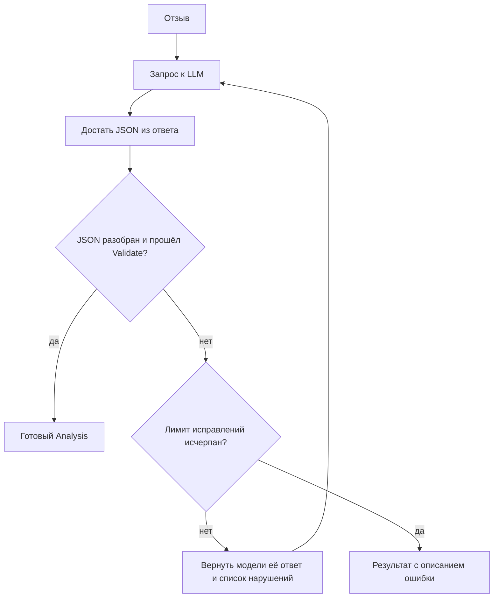

# review-analyzer

[](https://github.com/LarisaRodzhanovna/review-analyzer/actions/workflows/test.yml)

Go-утилита: прогоняет клиентские отзывы через LLM (YandexGPT или GigaChat) и возвращает структурированный разбор (тональность, категория, главная боль, дословная цитата-доказательство) плюс сводку по болям.

Только стандартная библиотека Go, без внешних зависимостей.

Главная идея: ответу модели не верят на слово. Он должен пройти проверку, и если не прошёл, модель получает свой же ответ вместе со списком нарушений и исправляется.

## Что получается на выходе

Для каждого отзыва в `results.json`:

```json
{
  "review": "Через месяц отвалилась ручка, пластик очень хлипкий.",
  "analysis": {
    "sentiment": "negative",
    "category": "качество",
    "pain": "Ручка отвалилась, пластик хлипкий",
    "quote": "Через месяц отвалилась ручка, пластик очень хлипкий."
  },
  "fixes": 0,
  "tokens": 193
}
```

И сводка в консоли (прогон на семи тестовых отзывах из `reviews.txt`):

```text
=== Итого: 7 отзывов ===
Тональность: 👍 1  😐 2  👎 4
Боли клиентов (негатив по категориям):
  доставка               █ 1
  описание_не_совпадает  █ 1
  сервис                 █ 1
  качество               █ 1
Качество: самоисправлений 0, не удалось разобрать 0, токенов всего 1342
```

## Как работает проверка и самоисправление



`Validate` проверяет не только формат, но и честность ответа:

| Поле | Что проверяется |
|---|---|
| `sentiment` | одно из `positive`, `negative`, `neutral` |
| `category` | одно из `качество`, `доставка`, `цена`, `сервис`, `описание_не_совпадает`, `другое` |
| `pain` | для негативного отзыва не пустое |
| `quote` | обязана дословно встречаться в отзыве (сравнение без учёта регистра, `ё`/`е` и лишних пробелов), иначе считаем галлюцинацией |

Модели любят оборачивать ответ в блок с markdown или добавлять «Вот ответ:», поэтому JSON вырезается из текста до разбора.

## Что внутри

| Что | Где | Зачем |
|---|---|---|
| OAuth 2.0 с кешем токена | `gigachat.go`, `getToken` | токен живёт 30 минут, обновляется за минуту до конца; на 401 принудительное обновление и повтор |
| Ретраи с exponential backoff и jitter | `gigachat.go`, `doWithRetry` | сетевые ошибки, 429 и 5xx; остальные 4xx не ретраим |
| Таймауты | `http.Client.Timeout`, `context` | ни один вызов не висит бесконечно |
| Строгий JSON-контракт | `analyze.go`, `Analysis` | перечисляемые значения, обязательная боль для негатива |
| Защита от галлюцинаций | `analyze.go`, `Validate` | цитата должна быть в отзыве |
| Самоисправление модели | `analyze.go`, `AnalyzeReview` | невалидный ответ и список нарушений уходят обратно в модель, до N раз (`-fixes`) |
| Два провайдера за одним интерфейсом | `LLM`, `yandexgpt.go`, `gigachat.go` | смена провайдера одной переменной `LLM_PROVIDER` |
| Структурные логи | `log/slog` | статус, номер попытки, время ответа, токены |
| Секреты только из окружения | `ConfigFromEnv`, `YandexConfigFromEnv` | ключи не попадают в код и репозиторий |

## Запуск с YandexGPT (по умолчанию)

Нужен Go 1.21 или новее.

1. Зайти в Yandex Cloud (console.yandex.cloud) по Яндекс ID, создать платёжный аккаунт (новым пользователям даётся стартовый грант).
2. Скопировать **ID каталога** (folder ID, вида `b1g...`): он виден в консоли рядом с названием каталога.
3. Создать **сервисный аккаунт** в этом каталоге с ролью `ai.languageModels.user`.
4. В сервисном аккаунте создать **API-ключ** (область действия `yc.ai.foundationModels.execute`). Секрет показывается один раз, его нужно сохранить.
5. Запустить:

```powershell
$env:YANDEX_API_KEY   = "AQVN..."
$env:YANDEX_FOLDER_ID = "b1g..."
go run . -in reviews.txt -out results.json
```

```bash
export YANDEX_API_KEY=AQVN... YANDEX_FOLDER_ID=b1g...
go run . -in reviews.txt -out results.json
```

Модель меняется через `YANDEX_MODEL` (`yandexgpt-lite/latest` по умолчанию, `yandexgpt/latest` для Pro).

## Запуск с GigaChat

У GigaChat свой корневой сертификат (НУЦ Минцифры), его нужно подключить:

```powershell
$env:LLM_PROVIDER      = "gigachat"
$env:GIGACHAT_AUTH_KEY = "ключ_авторизации"
$env:GIGACHAT_CA_FILE  = "C:\certs\russian_trusted_root_ca.cer"
go run .
```

Для локальной отладки проверку сертификата можно отключить переменной `GIGACHAT_INSECURE=1`. По умолчанию она включена, а при отключении в лог пишется предупреждение.

## Параметры

Флаги: `-in` (файл с отзывами, по одному на строку, строки с `#` пропускаются; по умолчанию `reviews.txt`), `-out` (куда сохранить результат; по умолчанию `results.json`), `-fixes` (сколько раз просить модель исправиться; по умолчанию 2).

Переменные окружения перечислены в [`.env.example`](.env.example). Файл `.env` программа сама не читает, переменные задаются в оболочке.

## Тесты

```bash
go test -v ./...
```

Тесты идут без сети, на поддельном сервере (`httptest`). Прогон занимает около пяти секунд, потому что ретраи ждут по-настоящему.

| Тест | Что проверяет |
|---|---|
| `TestHappyPathWithMarkdownWrapper` | ответ в обёртке с markdown и пояснением разбирается без исправлений |
| `TestRetryOn503` | два сбоя 503 подряд, успех на третьей попытке |
| `TestTokenRefreshOn401` | «протухший» токен: получаем новый и повторяем запрос |
| `TestSelfCorrectionOnHallucinatedQuote` | выдуманная цитата, модель получает список нарушений и исправляется (`fixes = 1`) |
| `TestGivesUpAfterMaxFixes` | после лимита исправлений возвращается ошибка, а не невалидный результат |
| `TestYandexClient` | 429 с повтором, заголовки `Api-Key` и `OpenAI-Project`, адрес модели `gpt://<folder>/...` |

## Статус и ограничения

Это прототип.

- Отзывы в `reviews.txt` выдуманные, их семь. В приведённом прогоне самоисправление не потребовалось (`fixes = 0` у всех). Сам механизм проверен тестом на поддельном сервере, а не живым прогоном.
- Отзывы обрабатываются последовательно, без параллелизма и ограничения скорости.
- Метрики качества классификации (точность на размеченной выборке) не считаются.

## Что дальше

- Параллельная обработка с ограничением конкурентности (worker pool и rate limit).
- Поиск похожих отзывов на эмбеддингах: основа для этого уже есть в [rag-demo](https://github.com/LarisaRodzhanovna/rag-demo).
- Обернуть в MCP-сервер, чтобы агент мог вызывать анализ как инструмент.

## Лицензия

[MIT](LICENSE)
